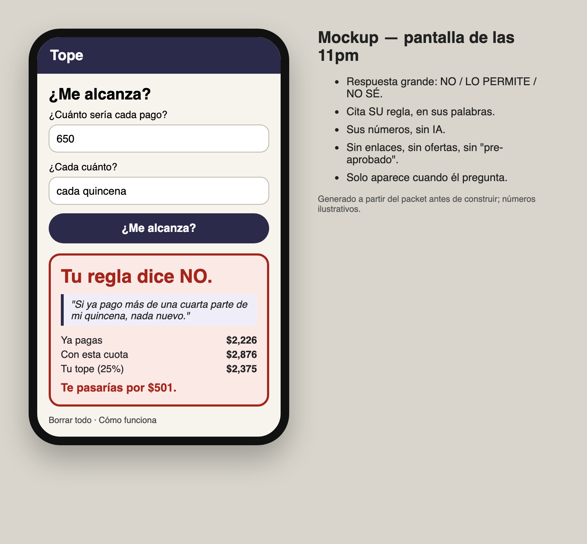
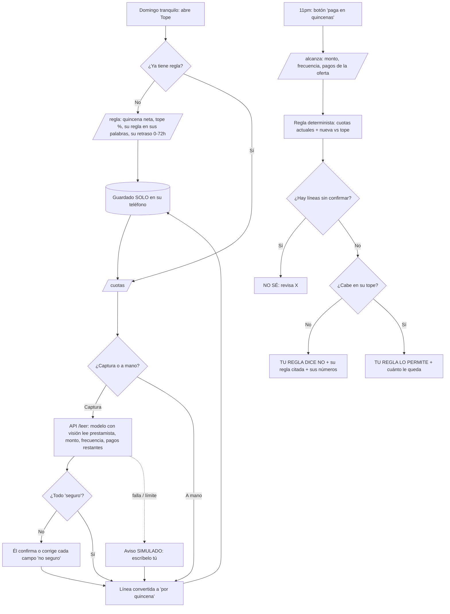
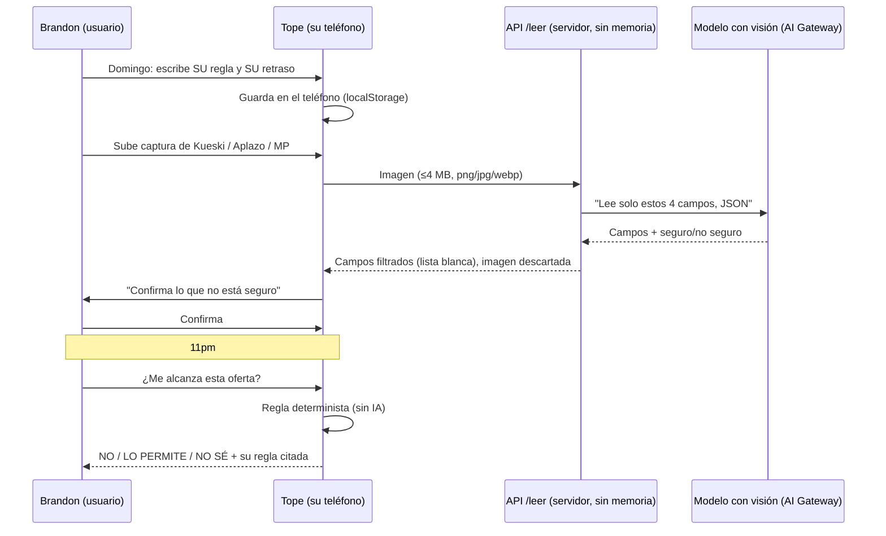

# Packet — w10-tope · "Tope: ¿me alcanza, según mi regla?"

> Written BEFORE the code (course discipline). Week 10 · Chapter 9 "Isle of Happiness" · T4 · ADVERSARY lens · Andrés Álvarez Morphy Namnum.
> Built from the vacuum my brief **failed to kill** (Debt guardrail, conditional survivor) and its conditions. When the T4 Blueprint exists, the "Conditions → build" table gets re-checked against it.

## The problem, in my words

Mexican retail removed the pause between **wanting** and **owing**. Credit now appears *at the button*, in quincenas, offered by the same company that sells (según DPL News, Kueski tripled its BNPL transactions on Amazon in 8 months, to 3M in Aug-2025; its users are 22–38 and prefer 4 quincenas). Each line looks small. The stack doesn't.

Nobody outside the lender can see the stack at the moment of the decision. The law that would let a third party pull the data — **Ley Fintech art. 76** — has had only its "open data" rules issued since 2018; the transactional rules are still pending. Buró de Crédito shows a history, once in a while, not at 11pm when the "5 quincenas" button appears. **The only live view belongs to the party that profits from a yes.**

My fight killed the general "buyer's agent" (every payer in Mexico sells or lends: MELI, OpenAI's merchant fee; corpses Honey and Mint), and killed "regret" as its own vacuum (sellers already prevent wrong-size returns because returns cost *them*). What survived is narrow: **add up all your cuotas against your quincena, with a rule you wrote yourself, and say "no" when your rule says no.**

## Exact user

- **"Brandon Ríos,"** 27, CDMX, customer-support job, net pay ~MX$9,500 per quincena. Has Kueski Pay (Amazon headphones), Aplazo (sneakers, in store), Mercado Pago (a phone, 12 MSI) and a Coppel account. Last month a quincena didn't cover the cuotas and he paid one late. He doesn't trust finance apps (he's seen the *montadeudas* stories) and would never link a bank. *(Invented persona, built from the week's research; not a real person.)*
- His question at 11pm: **"¿Me alcanza si le doy a 'pagar en quincenas'?"**
- His question on a calm Sunday: **"¿Cuánto debo en total cada quincena, de verdad?"**

## Definition of success

**Before the module closes**, at the live URL, with no account and nothing stored on a server:
1. **`/regla`** — on a calm Sunday he writes his rule: net pay per quincena, the max % of it that can go to cuotas (he picks the number), the rule in his own words (optional), and **his own delay** to change it later (0, 24, 48 or 72 h — zero allowed). Saved only on his phone.
2. **`/cuotas`** — he adds each line he owes. Either by **screenshot** (an LLM with vision reads lender, amount per payment, frequency and payments left; every field comes back as *seguro / no seguro*; anything *no seguro* must be confirmed by him before it counts), or by typing it. The image is never stored. Each line is converted to "per quincena".
3. **`/alcanza`** — the 11pm screen. He enters the new offer (amount per payment, frequency, number of payments). A **deterministic rule** (no LLM) computes: current cuotas per quincena + new → % of his quincena vs his cap. The answer is one of three, big: **"Tu regla dice NO"** · **"Tu regla lo permite"** · **"No sé: revisa"** (if any line is unconfirmed or data is missing). It quotes his rule in his words and shows his numbers. No alternatives, no products, no credit.
4. **Changing the rule respects his delay:** a looser rule becomes "pendiente hasta [fecha]" and the old one keeps answering until then. Tightening applies immediately.
5. **`/metrica`** — optional: totals from two of his Buró reports (saldo total, cuentas abiertas) → the change, with the caveats on screen (unreported lines don't appear; can't separate Tope from an aguinaldo).
6. **"Borrar todo"** in one tap, from every screen's footer.
7. If the vision model fails or is rate-limited, the screen says so and he types the line himself — labeled **SIMULADO / sin IA**, never a fabricated reading.

## Mockup (generated)

## Flow

**Swimlane — who does what (no lender anywhere in the diagram, on purpose):**

## Benchmark

**The best existing solution on Earth for this is** India's **Account Aggregator** framework (a consent manager separated from the lender: 24.4M users FY25, 269M+ consents, según Business Standard/Sahamati), with the UK's 2026 BNPL affordability rules putting the check on the lender. **Mine differs by** doing the check *for the buyer, with his own rule, from data he carries by hand* — because Mexico's equivalent pipe (art. 76) was never switched on and no rule obliges the lender.

## Long view (3 sentences)

If this slice works, Tope becomes the buyer-side ledger that art. 76 promised and never delivered: one place where all of a person's cuotas add up, owned by him, with no lender in the room. When buyer-side agents arrive, Tope is the rulebook those agents must obey — the agent proposes, the person's own rule disposes. It stays paid like a utility (same price for yes and no), never like a marketplace.

## Scope cut (what I'm NOT building this week)

- No account, no server database, no sync between devices (everything on his phone).
- No bank or lender connection, no API scraping, no Buró pull — data comes from him.
- No notifications, reminders or "tips" of any kind (pull-only is the shadow clause).
- No recommendations, no comparison of lenders, no "better offer", no credit of any kind (forbidden zone + condition 3).
- No reading of the Buró PDF by the LLM (only typed totals on `/metrica`), and no fiado ledger (my backup vacuum, not this week).
- No payment / pricing screen: the payer question is open and stated on `/como`.

## Conditions → how the build honors them

From my brief (section 4); re-check against the T4 Blueprint when it exists.

| # | Condition (each tied to a corpse) | How the build honors it |
|---|---|---|
| 1 | **Payer:** never per sale, per loan or per referral (Honey; Credit Karma) | No links out to any lender or store; no affiliate code anywhere; `/como` states the payer is unresolved and what it may never be |
| 2 | **Data from the user, never an API behind his back; totals only** (*montadeudas*; art. 76) | Screenshots processed in memory and discarded; no server storage; lines + rule in localStorage; "Borrar todo" on every screen |
| 3 | **Never show a credit offer** | No component, string or link can render one; tested in E2E (no lender URL, no "préstamo/consolida/pre-aprobado" on any page) |
| 4 | **Uncertain = "No sé, revisa"**, never a false yes | Any *no seguro* field blocks counting until confirmed; `/alcanza` returns NO SÉ if any line is unconfirmed |
| 5 | **Metric not engagement:** Buró delta, never time-in-app or count of "no"s | `/metrica` computes the delta with caveats; no analytics, no counters of answers |
| Shadow | **PULL-ONLY, HIS RULE:** never starts a conversation, never writes a rule, honors his own delay | No notification API used (Permissions-Policy blocks it); rule text is his; looser rule waits for his delay, tighter applies now |

## Dragon stack (multiplies, doesn't add)

**LLM + user-constraint data + vision**: vision turns a screenshot of any lender's cuota screen into structured lines (the only way to get the data without art. 76); his constraint data (quincena, cap, rule) decides; the LLM never decides — a deterministic rule does.

## Architecture and stack

| Layer | Choice | Why |
|---|---|---|
| Frontend | Next.js 15 (App Router) + Tailwind 4, phone-first | Same free stack as previous weeks |
| Storage | `localStorage` on his phone only | Condition 2: nothing on a server |
| Vision | `google/gemini-2.5-flash-lite` via Vercel AI Gateway (OIDC, no key in repo) | Free tier served it in Week 9; supports images |
| API | `POST /api/leer` — image in, whitelisted JSON out, stateless, rate-limited | The only server code; nothing logged |
| Rule engine | `lib/tope.js` — pure functions, unit-tested | The decision is deterministic and inspectable |
| Hosting | Vercel (class19), GitHub `andresbuildshub/w10-tope` | Free |

## Security floor

- 🔑 No secrets: AI Gateway authenticates by Vercel OIDC; nothing in the repo.
- 🔐 Auth: **not applicable** — nothing personal is stored on a server (same reasoning as Week 4 and Week 9; stated on `/como`).
- 🚪 RLS: no database.
- 🧹 Validation: image type (png/jpg/webp) and size (≤4 MB) checked server-side; numbers clamped (quincena 500–200,000; cap 1–90%; payments 1–60); rule text ≤200 chars; model output filtered to 4 whitelisted fields with numeric ranges.
- 🎭 Demo data: invented screenshots made for this project, watermarked "DEMO · datos inventados"; persona invented.

## Test plan

1. **Unit (node --test):** per-quincena conversion (semanal ×2.1667, mensual ÷2, quincenal ×1); NO/PERMITE/NO SÉ boundaries (exactly at the cap = permite); pending rule respects delay (looser waits, tighter applies now); output filter rejects out-of-range numbers and unknown fields.
2. **Vision, real:** 4 invented screenshots (Kueski-style, Aplazo-style, Mercado Pago MSI, Coppel estado) → compare extracted fields to the truth I wrote into them; count wrong-but-"seguro" fields (the false-yes risk).
3. **E2E (Playwright vs prod, phone viewport):** full flow regla → 3 cuotas → oferta that breaks the cap → NO; oferta that fits → PERMITE; one unconfirmed line → NO SÉ; "Borrar todo" empties storage; no page contains lender links or credit words.
4. **Persona test:** a fresh model plays Brandon, walks screenshots of each screen, narrates hesitation/quit points; log every confusion; fix the worst; re-test.
